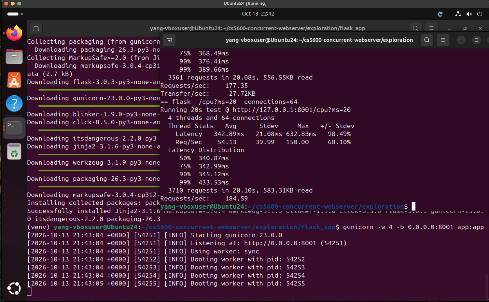
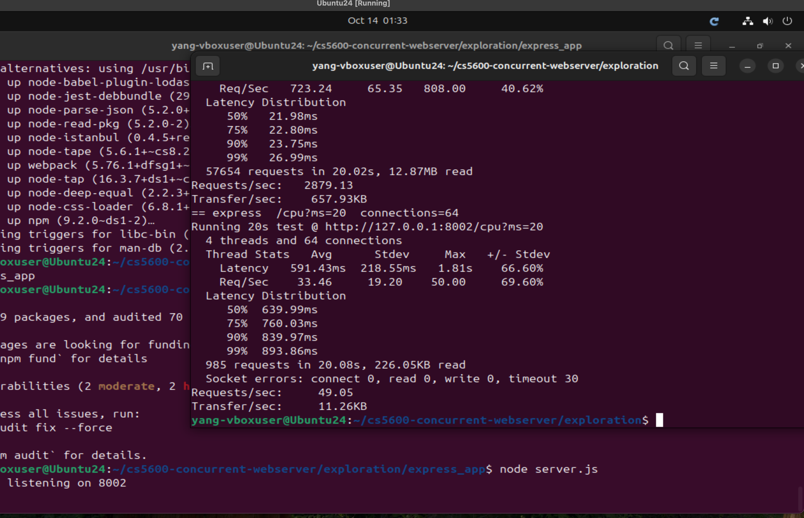
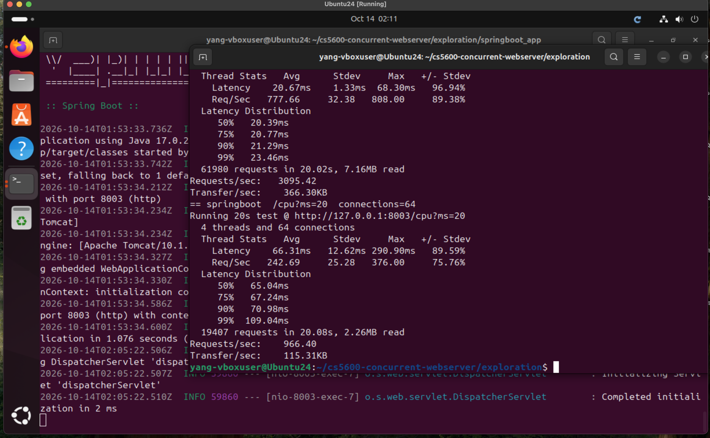

# Preliminary Exploration: Existing Web Server Implementations


## Goal

Before designing our own concurrent web server, we ran three widely used web server stacks on our VM under the same workload and looked at **how each one handles concurrency**: where requests wait, how many threads or processes do the work, and what happens when requests are CPU-heavy versus I/O-heavy. Each stack uses a different concurrency model, so together they cover the main design options we could take.

| System | Language | Concurrency model |
|---|---|---|
| Flask + gunicorn | Python | Pre-forked worker **processes**, one request at a time per process (sync workers) |
| Express (Node.js) | JavaScript | **Single-threaded event loop** with non-blocking I/O |
| Spring Boot (embedded Tomcat) | Java | Fixed-max **thread pool**, one thread per request, plus a separate accept queue |

## Test Setup

- **VM:** Ubuntu 24.04 (ARM64) in VirtualBox on an Apple M1 Pro MacBook, **1 vCPU**, 3.8 GiB RAM. The `wrk` load generator ran on the same VM, so it shared that single core with the server.
- **Load tool:** `wrk` (`sudo apt install wrk`), 4 client threads, 20 seconds per run, `--latency` for percentiles. All runs use `exploration/run_load.sh`, so every system gets exactly the same test.
- **Test apps:** each system serves the same three endpoints (code in `exploration/`):
  - `/hello`: tiny response, measures raw request-handling overhead
  - `/io?ms=20`: waits 20 ms without using the CPU, like a database or disk call
  - `/cpu?ms=20`: busy-loops for 20 ms, like a compute-heavy request
- **Concurrency levels:** 8 and 64 open connections.

How to reproduce:

```bash
# Flask + gunicorn (4 worker processes)
cd exploration/flask_app && pip install -r requirements.txt
gunicorn -w 4 -b 0.0.0.0:8001 app:app
# Express
cd exploration/express_app && npm install && node server.js
# Spring Boot (needs JDK 17 and Maven)
cd exploration/springboot_app && mvn -q spring-boot:run

# In another terminal, for each server:
cd exploration && ./run_load.sh 8001 flask     # 8002 express, 8003 springboot
```

---

## 1. Flask + gunicorn

**How it works.** Flask is just the application framework, and its built-in server is only meant for development. In production it runs behind gunicorn. With the default `sync` worker type, gunicorn starts a master process and forks a fixed number of worker processes (we used `-w 4`). Every worker accepts connections from the same listening socket and handles **one request at a time**, start to finish. So the most requests that can be in progress at once is the number of workers. Extra connections wait in the kernel's accept backlog, not in a queue that gunicorn controls.

**Screenshot** (gunicorn with 4 sync workers at the bottom, `wrk` results on the right):



More `wrk` output for all six runs: [part 1](images/flask_load_1.png), [part 2](images/flask_load_2.png), [part 3](images/flask_load_3.png). Raw text is in `exploration/results/flask/`.

**Results** (gunicorn `-w 4`, `wrk -t4 -d20s`)

| Endpoint | Connections | Requests/sec | p50 | p99 |
|---|---|---|---|---|
| /hello | 8 | 6,998 | 1.08 ms | 6.05 ms |
| /hello | 64 | 7,527 | 8.37 ms | 12.24 ms |
| /io?ms=20 | 8 | 175 | 45.17 ms | 55.00 ms |
| /io?ms=20 | 64 | 177 | 359.91 ms | 389.66 ms |
| /cpu?ms=20 | 8 | 182 | 42.63 ms | 111.00 ms |
| /cpu?ms=20 | 64 | 185 | 340.87 ms | 433.53 ms |

**Analysis.**

- **The worker count is a hard ceiling.** Each `/io` or `/cpu` request takes about 20 ms, and there are only 4 workers, so the best gunicorn can do is 4 / 0.020 s = 200 requests per second. We measured 175 to 185 for both endpoints, right under that limit. Going from 8 to 64 connections didn't raise throughput at all (175 to 177 for `/io`), because there was no free worker to take the extra requests.
- **Extra load just turns into waiting time.** With 64 connections, `/io` latency went from 45 ms to about 360 ms, even though each request only does 20 ms of work. That lines up with a simple queueing estimate: 64 connections shared by 4 workers means each request waits behind about 16 others, and 16 × 20 ms ≈ 320 ms, plus some overhead. So almost all of the latency is time spent waiting in line, not time doing work.
- **I/O requests are just as bad as CPU requests here.** The interesting part is that `/io` (which just sleeps) performed almost exactly like `/cpu` (which actually uses the CPU). A sync worker is stuck while its request sleeps, so the CPU sits idle while new requests pile up. A thread pool, or more workers, would let other requests run during those waits.
- **A note on `/cpu`.** The VM only has 1 vCPU, so real CPU capacity is about 1 / 0.020 s = 50 requests per second. Gunicorn reported 182 to 185 for `/cpu`, which is more than the core can actually do. That's because our busy-loop stops after 20 ms of wall-clock time, so when 4 worker processes take turns on one core, each one "finishes" without really getting 20 ms of CPU. We explain this more in the Spring Boot section.
- **Tiny requests are fine.** `/hello` handled around 7,000 to 7,500 requests per second, with p99 still around 12 ms at 64 connections, because each request finishes in well under a millisecond and the workers free up right away.
- **Takeaway for our project.** Gunicorn's pool size is fixed when the server starts. With 4 workers it was badly undersized for this I/O-heavy workload, but for `/hello` it was more than enough. Picking a single number ahead of time doesn't work well for every workload, which is exactly the problem our adaptive thread pool is meant to address.

## 2. Express (Node.js)

**How it works.** Node runs all JavaScript on **one event-loop thread**. Network I/O is non-blocking, and timers and sockets are handled by libuv. Libuv also has a small internal thread pool (4 threads by default), but it is only used for things like file system calls and DNS, not for running request handlers. A handler that waits on I/O (`setTimeout`, an async DB call) gives the event loop back so other requests can run. A handler that does CPU work holds the only thread until it finishes.

**Screenshot** (`node server.js` listening on 8002 at the bottom, `wrk` results on the right):



More `wrk` output for all six runs: [part 1](images/express_load_1.png), [part 2](images/express_load_2.png), [part 3](images/express_load_3.png), [part 4](images/express_load_4.png). Raw text is in `exploration/results/express/`.

**Results** (single Node process, `wrk -t4 -d20s`)

| Endpoint | Connections | Requests/sec | p50 | p99 |
|---|---|---|---|---|
| /hello | 8 | 13,760 | 0.52 ms | 3.81 ms |
| /hello | 64 | 13,607 | 4.21 ms | 9.99 ms |
| /io?ms=20 | 8 | 365 | 21.53 ms | 27.09 ms |
| /io?ms=20 | 64 | 2,879 | 21.98 ms | 26.99 ms |
| /cpu?ms=20 | 8 | 50 | 160.00 ms | 194.52 ms |
| /cpu?ms=20 | 64 | 49 | 639.99 ms | 893.86 ms (30 timeouts) |

**Analysis.**

- **I/O-heavy requests scale almost perfectly.** For `/io`, going from 8 to 64 connections raised throughput from 365 to 2,879 requests per second, which is almost exactly 8 times higher, while p50 stayed at about 22 ms (just the 20 ms wait plus a little overhead). Since the wait is non-blocking, all 64 requests can be waiting at the same time on one thread. Compared to gunicorn's 177 requests per second and 390 ms p99 on the same test, Express is about 16 times faster here.
- **CPU-heavy requests are the worst case.** For `/cpu`, throughput is stuck at about 50 requests per second, which is exactly 1 / 0.020 s, since only one request can run at a time on the single thread. Express is also the only one of the three whose `/cpu` numbers reflect real CPU work, because nothing can interrupt the busy-loop on its single JavaScript thread. With 8 connections, each request waits behind the other 7, so p50 is 8 × 20 ms = 160 ms. That matches our measurement exactly. With 64 connections, p99 jumped to almost 900 ms and 30 requests timed out.
- **One slow request blocks everyone else.** This is head-of-line blocking: while a CPU-bound handler is running, the event loop can't accept, parse or answer anything else, even a cheap request.
- **Tiny requests are very fast.** `/hello` handled about 13,700 requests per second, roughly twice as many as gunicorn, because there are no processes to switch between.
- **Takeaway for our project.** Express and gunicorn fail in opposite ways. Express handles waiting well but can't run CPU work in parallel, while gunicorn's sync workers run CPU work in parallel but waste their slots while waiting. A pool of real threads sits in between, and how many threads to use depends on the CPU/I/O mix, which is why our workload generator mixes both kinds of requests.

## 3. Spring Boot (embedded Tomcat)

**How it works.** Spring Boot runs an embedded Tomcat server. Tomcat has an acceptor thread that takes new connections and a **worker thread pool** (`server.tomcat.threads.max`, default 200) that runs the request handlers, one thread per request for the whole request. You can see these workers in the log as `nio-8003-exec-N`. When all worker threads are busy, new connections wait in a queue whose size is set by `accept-count` (default 100). This is the closest of the three to our own design: one thread accepting connections and a bounded pool of workers behind it.

**Screenshot** (Spring Boot log with Tomcat on port 8003 on the left, `wrk` results on the right):



More `wrk` output for all six runs: [part 1](images/springboot_load_1.png), [part 2](images/springboot_load_2.png), [part 3](images/springboot_load_3.png). Raw text is in `exploration/results/springboot/`.

**Results** (Tomcat, default max 200 threads, `wrk -t4 -d20s`)

| Endpoint | Connections | Requests/sec | p50 | p99 |
|---|---|---|---|---|
| /hello | 8 | 20,344 | 0.36 ms | 5.94 ms |
| /hello | 64 | 22,123 | 2.15 ms | 51.93 ms |
| /io?ms=20 | 8 | 370 | 21.12 ms | 26.99 ms |
| /io?ms=20 | 64 | 3,095 | 20.39 ms | 23.46 ms |
| /cpu?ms=20 | 8 | 327 | 24.03 ms | 30.93 ms |
| /cpu?ms=20 | 64 | 966 | 65.04 ms | 109.04 ms |

**Analysis.**

- **Best I/O results of the three.** With 64 connections, `/io` reached 3,095 requests per second with a p99 of just 23 ms, slightly better than Express and about 17 times better than gunicorn's 390 ms.
- **Why I/O scales.** With a 200-thread pool, all 64 connections get their own thread, so each blocking 20 ms wait just occupies one thread while the others keep working. Nothing waits in the queue, so latency stays right at the 20 ms of real work. This is the "throw a lot of threads at it" approach.
- **The `/cpu` numbers are misleading, and this is an important finding.** Spring Boot reported 966 requests per second for `/cpu` at 64 connections. But our VM only has 1 vCPU, which can do at most 1 / 0.020 s = 50 requests per second of real 20 ms CPU work. The reason is our test design: the busy-loop stops after 20 ms of *wall-clock* time, not 20 ms of actual CPU time. When 64 threads share one core, a thread that gets paused by the OS still "finishes" once 20 ms have passed, even if it barely ran. So the more threads a server has, the better it looks on this test, which is backwards. Express (one thread, 50 requests per second) is the only server whose `/cpu` result matches what the core can really do. For our own workload generator, we will define CPU work as a fixed number of loop iterations instead of a time limit, so every request does the same real amount of work no matter how many threads there are.
- **The cost.** Tomcat keeps up to 200 threads, each with its own stack, even though in our test at most 64 were ever needed. At low load, most of them would just sit idle. And `/hello` at 64 connections already shows a p99 of 52 ms despite p50 being only 2 ms, which suggests extra scheduling and context-switch overhead from running so many threads on a single core.
- **Takeaway for our project.** Tomcat works well for I/O here mostly because its fixed pool is very large. That's a reasonable default, but it wastes memory when traffic is light, and it still can't react to the workload. This is the trade-off our adaptive thread pool tries to fix: start small like gunicorn, grow toward Tomcat's behavior when the queue builds up, and shrink again when it's idle.

---

## Comparison

| | Flask + gunicorn | Express | Spring Boot |
|---|---|---|---|
| Unit of concurrency | Process | Callback on one thread | Thread |
| Where waiting requests sit | Kernel accept backlog | Event loop queue | Tomcat accept queue |
| Good at | Isolation | Lots of I/O waiting | Mixed workloads |
| Weak at | Fixed small pool, I/O-heavy traffic | CPU-heavy requests | Memory, fixed large pool |
| Pool size adapts to load? | No | N/A | No (fixed max) |
| /io p99 at 64 connections | 390 ms | 27 ms | 23 ms |
| /cpu p99 at 64 connections* | 434 ms | 894 ms (30 timeouts) | 109 ms |

\* On our 1-vCPU VM the `/cpu` results for gunicorn and Spring Boot are inflated by the wall-clock busy-loop (see the Spring Boot analysis). Only Express's `/cpu` numbers reflect real CPU capacity.

## What This Means for Our Design

1. **Separating "accept" from "work" is the right structure.** Spring Boot / Tomcat uses a dedicated acceptor and a worker pool, which is the same master/worker producer-consumer design the OSTEP project asks for. Unlike gunicorn, it lets us see and control the queue ourselves, so we can measure queueing delay directly.
2. **No single fixed pool size works for every workload.** Gunicorn's small fixed pool limits I/O-heavy traffic, while Tomcat's large fixed pool handles both well in our tests but keeps up to 200 threads around whether they are needed or not. This is the gap our research extension (AdaptivePool) is aimed at: sizing the pool from the observed queue length instead of picking a number ahead of time.
3. **CPU-heavy requests need real threads, and a fair benchmark.** Express shows that an event loop alone cannot stop one CPU-heavy request from delaying everyone else. Our workload generator should include CPU-bound and I/O-bound requests separately so we can see this effect in our own server, and CPU work must be measured in real work (loop iterations), not wall-clock time, or a server with more threads will look faster than it is. We also plan to give the VM more vCPUs so that thread count actually matters for CPU-bound requests.
4. **Tail latency shows the problems that averages hide.** For Spring Boot `/hello` at 64 connections, p50 was only 2.15 ms but p99 was 51.93 ms, about 24 times worse. For gunicorn `/cpu` at 8 connections, p50 was 42.63 ms but p99 was 111 ms. If we only reported averages, these spikes would disappear, so p99 will be our main metric.
